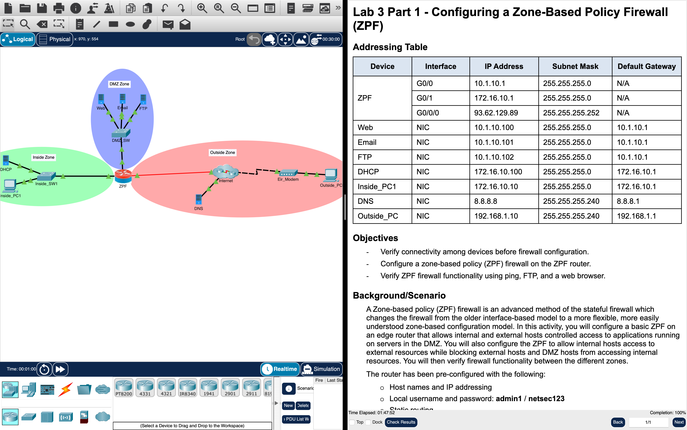
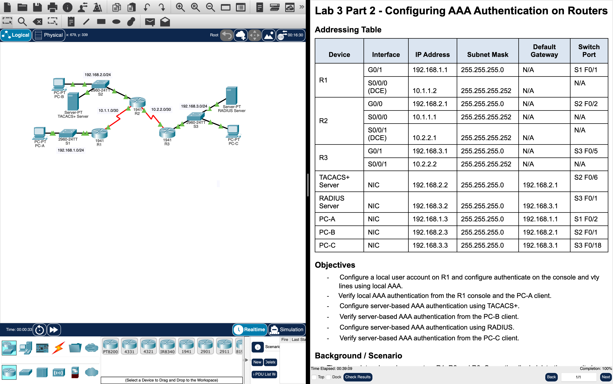

# Week 05 — Lab 3: zone-based firewalls and AAA authentication on routers (Packet Tracer)

**Module:** Network Security (`DFCS H3015`)  
**Semester:** 6 (Year 3), folder `sem06`

[Module README](../README.md)

## What this week is for

Lecture 5 was device monitoring and management. Lab 3 has two parts. Part 1 configures a zone-based policy firewall (ZPF), an advanced stateful firewall method that replaces the older interface-based one, on the ZPF router that connects an internal network with a web, an e-mail and an FTP server, a second network with a DHCP server and the outside: verify the connectivity before the firewall configuration, configure the ZPF firewall and verify it with ping, FTP and a web browser. Part 2 configures AAA authentication on routers: a local user account on R1 with local AAA on the console and the VTY lines (verified from the R1 console and PC-A), server-based AAA with TACACS+ (verified from PC-B) and server-based AAA with RADIUS (verified from PC-C). The folder [`resources/`](resources/) has a one-page cheat sheet on the IOS zone-based firewall.

## Screenshots

*The Lab 3 part 1 activity in Packet Tracer: the ZPF router with the inside, DMZ and outside zones next to the instructions, with the check results at 100%.*

*The Lab 3 part 2 activity in Packet Tracer: the routers R1, R2 and R3 with the TACACS+ and RADIUS servers next to the instructions, with the check results at 100%.*

## Files

| File | What it contains |
|---|---|
| [`README.md`](README.md) | This README. |
| [`lab/network_security_week05_lab_configuring_a_zone_based_policy_firewall_zpf.docx`](lab/network_security_week05_lab_configuring_a_zone_based_policy_firewall_zpf.docx) | The lab instructions of part 1 (Word): Lab 3 Part 1 - Configuring a Zone-Based Policy Firewall (ZPF), with the topology, the addressing table and the objectives. |
| [`lab/network_security_week05_lab_configuring_a_zone_based_policy_firewall_zpf.pdf`](lab/network_security_week05_lab_configuring_a_zone_based_policy_firewall_zpf.pdf) | The lab instructions of part 1 as a PDF (5 pages), exported from Packet Tracer: the same text as the Word file. |
| [`lab/network_security_week05_lab_configuring_a_zone_based_policy_firewall_zpf.pka`](lab/network_security_week05_lab_configuring_a_zone_based_policy_firewall_zpf.pka) | The Packet Tracer activity of part 1: the starting network. Packet Tracer saves files in an encrypted format, so this file opens only in Cisco Packet Tracer and its contents are not shown in the repository. |
| [`lab/solution/network_security_week05_lab_configuring_a_zone_based_policy_firewall_zpf_solution.pka`](lab/solution/network_security_week05_lab_configuring_a_zone_based_policy_firewall_zpf_solution.pka) | The Packet Tracer file after part 1: the same network with the zone-based policy firewall configured. Packet Tracer saves files in an encrypted format, so this file opens only in Cisco Packet Tracer and its contents are not shown in the repository. |
| [`lab/network_security_week05_lab_configuring_aaa_authentication_on_routers.docx`](lab/network_security_week05_lab_configuring_aaa_authentication_on_routers.docx) | The lab instructions of part 2 (Word): Lab 3 Part 2 - Configuring AAA Authentication on Routers, with the topology and the objectives. |
| [`lab/network_security_week05_lab_configuring_aaa_authentication_on_routers.pdf`](lab/network_security_week05_lab_configuring_aaa_authentication_on_routers.pdf) | The lab instructions of part 2 as a PDF (3 pages), exported from Packet Tracer: the same text as the Word file. |
| [`lab/network_security_week05_lab_configuring_aaa_authentication_on_routers.pka`](lab/network_security_week05_lab_configuring_aaa_authentication_on_routers.pka) | The Packet Tracer activity of part 2: the starting network. Packet Tracer saves files in an encrypted format, so this file opens only in Cisco Packet Tracer and its contents are not shown in the repository. |
| [`lab/solution/network_security_week05_lab_configuring_aaa_authentication_on_routers_solution.pka`](lab/solution/network_security_week05_lab_configuring_aaa_authentication_on_routers_solution.pka) | The Packet Tracer file after part 2: the same network with the local, TACACS+ and RADIUS authentication configured. Packet Tracer saves files in an encrypted format, so this file opens only in Cisco Packet Tracer and its contents are not shown in the repository. |
| [`resources/ios_zone_based_firewall.pdf`](resources/ios_zone_based_firewall.pdf) | The IOS Zone-Based Firewall cheat sheet (1 page, version 1.0, by Jeremy Stretch of packetlife.net): the terminology (security zone, zone pair, inspection policy and parameter map), a diagram of a router with the zones Trusted, Guest and Internet, and the configuration with examples: the security zones and the interfaces in them, the inspection class maps (by protocol and by access list), the parameter map, the policy actions (drop, pass and inspect), the inspection policy map, the zone pairs, and the show and debug commands for troubleshooting. |
