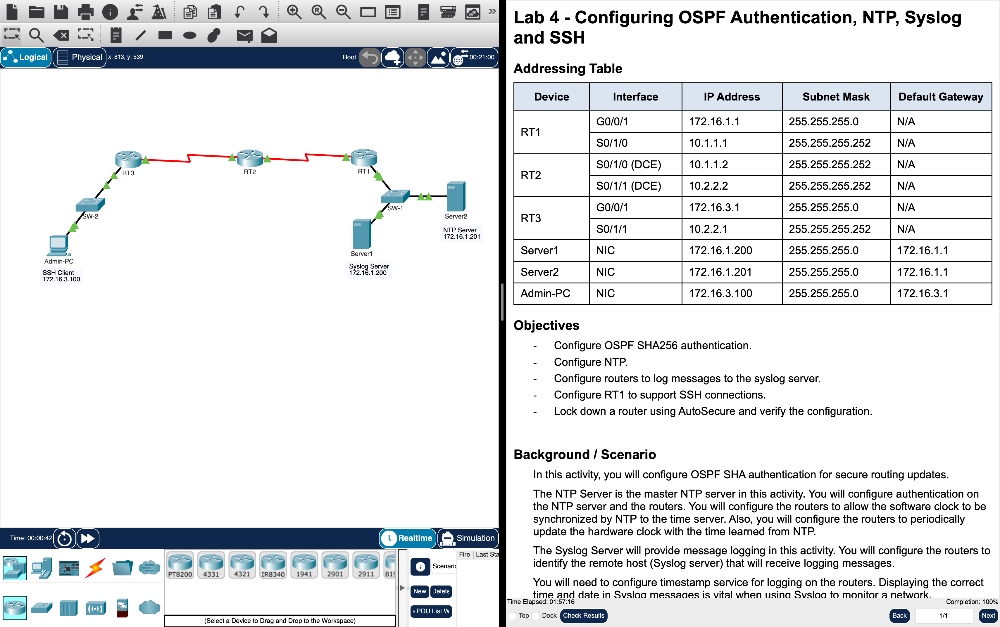

# Week 07 — Lab 4: OSPF authentication, NTP, syslog and SSH (Packet Tracer)

**Module:** Network Security (`DFCS H3015`)  
**Semester:** 6 (Year 3), folder `sem06`

[Module README](../README.md)

## What this week is for

Lecture 7 was securing the local area network. Lab 4 secures the routers of a network: configure OSPF SHA256 authentication for secure routing updates, configure NTP, configure the routers to log messages to the syslog server, configure the router RT1 to support SSH connections, and lock down a router with AutoSecure and verify the configuration.

## Screenshots

*The Lab 4 activity in Packet Tracer: the routers RT1, RT2 and RT3 with the syslog server, the NTP server and the Admin-PC next to the instructions, with the check results at 100%.*

## Files

| File | What it contains |
|---|---|
| [`README.md`](README.md) | This README. |
| [`lab/network_security_week07_lab_configuring_ospf_authentication_ntp_syslog_and_ssh.docx`](lab/network_security_week07_lab_configuring_ospf_authentication_ntp_syslog_and_ssh.docx) | The lab instructions (Word): Lab 4 - Configuring OSPF Authentication, NTP, Syslog and SSH, with the objectives and the steps. |
| [`lab/network_security_week07_lab_configuring_ospf_authentication_ntp_syslog_and_ssh.pdf`](lab/network_security_week07_lab_configuring_ospf_authentication_ntp_syslog_and_ssh.pdf) | The lab instructions as a PDF (7 pages), exported from Packet Tracer: the same text as the Word file. |
| [`lab/network_security_week07_lab_configuring_ospf_authentication_ntp_syslog_and_ssh.pka`](lab/network_security_week07_lab_configuring_ospf_authentication_ntp_syslog_and_ssh.pka) | The Packet Tracer activity of the lab: the starting network. Packet Tracer saves files in an encrypted format, so this file opens only in Cisco Packet Tracer and its contents are not shown in the repository. |
| [`lab/solution/network_security_week07_lab_configuring_ospf_authentication_ntp_syslog_and_ssh_solution.pka`](lab/solution/network_security_week07_lab_configuring_ospf_authentication_ntp_syslog_and_ssh_solution.pka) | The Packet Tracer file after the lab: the same network with the OSPF authentication, NTP, syslog and SSH configured. Packet Tracer saves files in an encrypted format, so this file opens only in Cisco Packet Tracer and its contents are not shown in the repository. |
| [`resources/vlan_command_reference.pdf`](resources/vlan_command_reference.pdf) | The VLAN command reference (1 page): the commands to create a VLAN on a switch, create an SVI (a VLAN interface), put a switch port into a VLAN and create a sub-interface with dot1q encapsulation on a router, each with an example for VLAN 100. |
