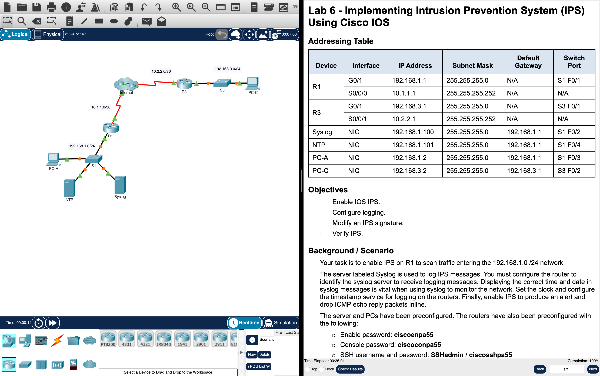

# Week 09 — Lab 6: intrusion prevention system using Cisco IOS (Packet Tracer)

**Module:** Network Security (`DFCS H3015`)  
**Semester:** 6 (Year 3), folder `sem06`

[Module README](../README.md)

## What this week is for

Lecture 9 was cryptographic systems. Lab 6 enables IPS on R1 to scan the traffic that enters the 192.168.1.0 network: enable IOS IPS, configure logging, modify an IPS signature and verify the IPS.

## Screenshots

*The Lab 6 activity in Packet Tracer: the routers R1 and R3, the syslog and NTP servers and the PCs next to the instructions, with the check results at 100%.*

## Files

| File | What it contains |
|---|---|
| [`README.md`](README.md) | This README. |
| [`lab/network_security_week09_lab_implementing_intrusion_prevention_system_ips_using_cisco_ios.docx`](lab/network_security_week09_lab_implementing_intrusion_prevention_system_ips_using_cisco_ios.docx) | The lab instructions (Word): Lab 6 - Implementing Intrusion Prevention System (IPS) Using Cisco IOS, with the objectives and the steps. |
| [`lab/network_security_week09_lab_implementing_intrusion_prevention_system_ips_using_cisco_ios.pdf`](lab/network_security_week09_lab_implementing_intrusion_prevention_system_ips_using_cisco_ios.pdf) | The lab instructions as a PDF (3 pages), exported from Packet Tracer: the same text as the Word file. |
| [`lab/network_security_week09_lab_implementing_intrusion_prevention_system_ips_using_cisco_ios.pka`](lab/network_security_week09_lab_implementing_intrusion_prevention_system_ips_using_cisco_ios.pka) | The Packet Tracer activity of the lab: the starting network. Packet Tracer saves files in an encrypted format, so this file opens only in Cisco Packet Tracer and its contents are not shown in the repository. |
| [`lab/solution/network_security_week09_lab_implementing_intrusion_prevention_system_ips_using_cisco_ios_solution.pka`](lab/solution/network_security_week09_lab_implementing_intrusion_prevention_system_ips_using_cisco_ios_solution.pka) | The Packet Tracer file after the lab: the same network with the IOS IPS enabled, the logging configured and the signature modified. Packet Tracer saves files in an encrypted format, so this file opens only in Cisco Packet Tracer and its contents are not shown in the repository. |
