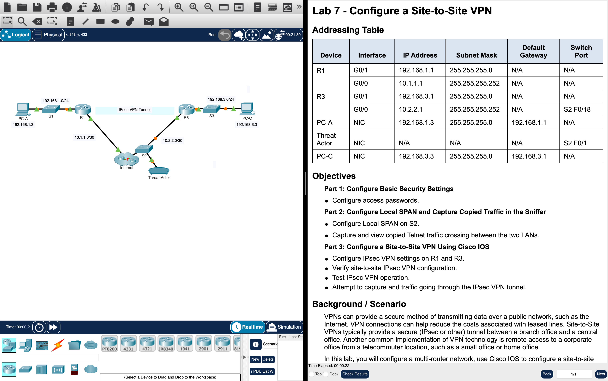

# Week 11 — Lab 7: site-to-site VPN (hardware and Packet Tracer)

**Module:** Network Security (`DFCS H3015`)  
**Semester:** 6 (Year 3), folder `sem06`

[Module README](../README.md)

## What this week is for

Lecture 11 was network security testing. Lab 7 configures a site-to-site VPN between two LANs, with R2 acting as the ISP. There are two versions: the hardware lab (room E125) and a Packet Tracer version. Both have three parts: configure the basic device settings (hostnames, interface addresses and access passwords; in the hardware lab also the OSPF routing protocol), configure a local SPAN on a switch and capture the copied Telnet traffic that crosses between the two LANs in Wireshark (in the sniffer in Packet Tracer), and configure a site-to-site VPN with Cisco IOS: IPsec VPN settings on R1 and R3, verify the configuration, test the VPN and try to capture the traffic that goes through the tunnel.

## Screenshots

*The Lab 7 activity in Packet Tracer: the routers R1 and R3, the switches, the Internet and the Threat-Actor, with the IPsec VPN tunnel label between the two LANs, next to the instructions with the three parts.*

## Files

| File | What it contains |
|---|---|
| [`README.md`](README.md) | This README. |
| [`lab/network_security_week11_lab_configure_a_site_to_site_vpn_hardware_lab.docx`](lab/network_security_week11_lab_configure_a_site_to_site_vpn_hardware_lab.docx) | The lab instructions of the hardware lab (Word): Lab 7 - Configure a Site-to-Site VPN (E125), three parts. |
| [`lab/network_security_week11_lab_configure_a_site_to_site_vpn.docx`](lab/network_security_week11_lab_configure_a_site_to_site_vpn.docx) | The lab instructions of the Packet Tracer version (Word): Lab 7 - Configuring a Site-to-Site VPN, three parts. |
| [`lab/network_security_week11_lab_configure_a_site_to_site_vpn.pdf`](lab/network_security_week11_lab_configure_a_site_to_site_vpn.pdf) | The lab instructions of the Packet Tracer version as a PDF (11 pages), exported from Packet Tracer: the same text as the Word file. |
| [`lab/network_security_week11_lab_configure_a_site_to_site_vpn.pka`](lab/network_security_week11_lab_configure_a_site_to_site_vpn.pka) | The Packet Tracer activity of the Packet Tracer version: the starting network. Packet Tracer saves files in an encrypted format, so this file opens only in Cisco Packet Tracer and its contents are not shown in the repository. |
